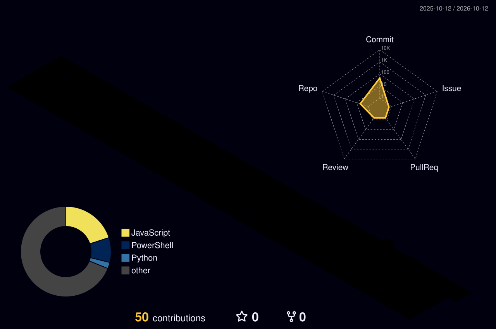

<div align="center">


<a href="https://git.io/typing-svg"></a>

<p>


</p>

<p>
<a href="#-about">About</a> •
<a href="#-live-status">Live Status</a> •
<a href="#-latest-activity">Activity</a> •
<a href="#-stack">Stack</a> •
<a href="#-stats">Stats</a> •
<a href="#-contributions">Contributions</a> •
<a href="#-featured-repositories">Repositories</a> •
<a href="#-connect">Connect</a>
</p>

</div>


---

### 🌌 ABOUT


```python
class EmonHMamun:
    """Security Researcher | Automation Architect | System Builder"""
    def __init__(self):
        self.base       = "Bangladesh"
        self.languages  = ["Python", "TypeScript", "Bash", "Go"]
        self.domains    = ["Security Research", "Automation", "Systems Engineering"]
        self.philosophy = "I build what watches the perimeter."
        self.currently  = "Building autonomous defense systems"
```

<!--DYNAMIC:START-->
<div align="center">


🛰️ **`রাত ৯:৪৫` · `সোমবার, ১২ অক্টোবর ২০২৬`** *(GMT+6 · auto-refreshed every 30 min by GitHub Actions)*

> 💬 *"The function of good software is to make the complex appear simple."*
> — **Grady Booch** <sub>· via Local Vault</sub>

</div>
<!--DYNAMIC:END-->

---

### 🛰️ LIVE STATUS

<div align="center">

<!-- LIVE_STATUS_START -->
<table>
<tr><td></td><td></td><td></td></tr>
<tr><td></td><td></td><td></td></tr>
<tr><td></td><td></td><td></td></tr>
</table>
<!-- LIVE_STATUS_END -->


</div>

---

### 📡 LATEST ACTIVITY

<!--START_SECTION:activity-->

- 🔀 Opened PR **#2** in `emonhmamun` · _12 Oct 2026, 02:04 PM_
- 🚀 Released **v1.5.0** of `aurora-clock` · _03 Oct 2026, 11:57 PM_
- 🌱 Created `main` branch in `aurora-clock` · _03 Oct 2026, 11:57 PM_
- 🌱 Created `main` branch in `persistmark-extension` · _02 Oct 2026, 09:32 AM_
- 🕒 Pushed **1 commit** to `persistmark-extension` · _02 Oct 2026, 10:56 AM_
- 🕒 Pushed **1 commit** to `persistmark-extension` · _02 Oct 2026, 11:09 AM_

<sub>🔄 auto-refreshed from the GitHub Events API every 6 hours by `.github/workflows/update-readme.yml`</sub>

<!--END_SECTION:activity-->

---

### 🛡️ STACK

<div align="center">

<a href="https://skillicons.dev"></a>
<br/><br/>
<a href="https://skillicons.dev"></a>

<br/><br/>


</div>

---

### 📊 STATS

<div align="center">

<table><tr>
<td>

</td>
<td>

</td>
<td>

</td>
</tr></table>

</div>

---

### 📈 CONTRIBUTIONS

<div align="center">




<picture>
  <source media="(prefers-color-scheme: dark)" srcset="https://raw.githubusercontent.com/emonhmamun/emonhmamun/output/snake-dark.svg" />
  
</picture>


</div>

---

### 📦 FEATURED REPOSITORIES

<div align="center">

<table><tr>
<td width="50%">
<a href="https://github.com/emonhmamun/NeoMate-Agent-AI">
  
</a>
</td>
<td width="50%">
<a href="https://github.com/emonhmamun/aurora-clock">
  
</a>
</td>
</tr><tr>
<td width="50%">
<a href="https://github.com/emonhmamun/CleanSweep-Pro">
  
</a>
</td>
<td width="50%">
<a href="https://github.com/emonhmamun/persistmark-extension">
  
</a>
</td>
</tr></table>

</div>

<details>
<summary><h3>🎯 Current Focus</h3></summary>

| Domain | Direction | Status |
|:------:|:---------:|:------:|
| Security Research | Threat analysis, OSINT, penetration testing | Active |
| Automation Systems | Autonomous security & workflow tooling | Building |
| AI Integration | ML/AI for security analysis & automation | Experimenting |
| Container Security | Docker/K8s hardening & runtime protection | Learning |

</details>

---

### 🔗 CONNECT

<div align="center">

<a href="https://github.com/emonhmamun"></a>
<a href="https://www.facebook.com/emonhasanmamun.m"></a>
<a href="https://t.me/+8801767953971"></a>
<a href="mailto:ehm.businessbd@gmail.com"></a>

</div>

---

<div align="center">


</div>
