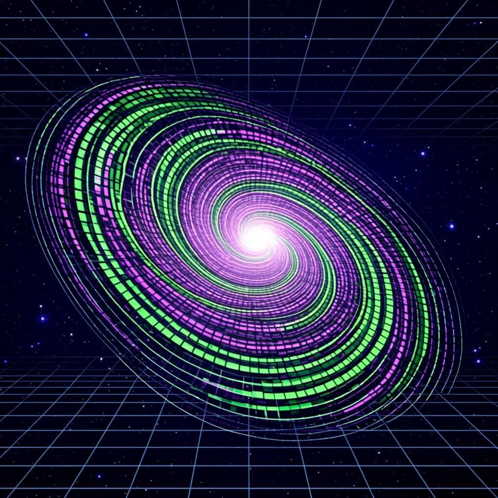

<div align="center">


 &nbsp;
<a href="https://git.io/typing-svg"></a> &nbsp;


<p>


</p>
<p>


</p>

<p>
<a href="#-terminal-access">💻 Terminal</a> •
<a href="#-who-am-i">🌌 Who Am I</a> •
<a href="#-live-coding-status">🛰️ Live Status</a> •
<a href="#-latest-activity">📡 Activity</a> •
<a href="#-tech-arsenal">🛡️ Arsenal</a> •
<a href="#-stats--analytics">📊 Stats</a> •
<a href="#-contribution-galaxy">🌠 Galaxy</a> •
<a href="#-contribution-snake">🐍 Snake</a> •
<a href="#-trophy-case">🏆 Trophies</a> •
<a href="#-featured-repositories">📦 Repos</a> •
<a href="#-connect">🔗 Connect</a>
</p>

</div>


---

### 💻 TERMINAL ACCESS

```bash
$ whoami
> emonhmamun | Security Researcher & System Builder

$ cat philosophy.txt
> [+] I build what watches the perimeter
> [+] Curiosity-driven, not profession-defined
> [+] Autonomous defense > manual response

$ neofetch --profile
> OS      : Arch Linux / Debian
> Editor  : Neovim (quick) + VS Code (heavy)
> Shell   : zsh + starship
> Langs   : Python, TypeScript, Bash, Go
> Cloud   : AWS, Docker, K8s
> Fun     : CTF, HTB, Building READMEs
```

---

<div align="center">

### 🌌 WHO AM I


```python
class EmonHMamun:
    """Security Researcher | Automation Architect | System Builder"""
    def __init__(self):
        self.base           = "Bangladesh"
        self.languages      = ["Python", "JavaScript", "TypeScript", "Bash", "Go"]
        self.domains        = ["Security Research", "Automation", "Systems Engineering"]
        self.philosophy     = "I build what watches the perimeter."
        self.motto          = "Curiosity-driven, not profession-defined."
        self.currently      = "Building autonomous defense systems"

    def __repr__(self):
        return f"{self.philosophy} | {self.motto}"
```

</div>

---

<!--DYNAMIC:START-->
<div align="center">


🛰️ **`দুপুর ২:০১` · `সোমবার, ১২ অক্টোবর ২০২৬`** *(GMT+6 · auto-refreshed every 30 min by GitHub Actions)*

> 💬 *"The only truly secure system is one that is powered off."*
> — **Gene Spafford** <sub>· via Local Vault</sub>

</div>
<!--DYNAMIC:END-->

---

<div align="center">

### 🛰️ LIVE CODING STATUS

<!-- LIVE_STATUS_START -->
<table><tr>
<td></td>
<td></td>
</tr></table>

<table><tr>
<td></td>
<td></td>
</tr></table>

<table><tr>
<td></td>
<td></td>
</tr></table>

<table><tr>
<td></td>
<td></td>
</tr></table>

<table><tr>
<td></td>
<td></td>
<td></td>
</tr></table>

<table><tr>
<td></td>
<td></td>
</tr></table>
<!-- LIVE_STATUS_END -->

<br/>

 &nbsp;
 &nbsp;


</div>

---

<div align="center">

### 📡 LATEST ACTIVITY

<!--START_SECTION:activity-->

- 🚀 Released **v1.5.0** of `aurora-clock` · _03 Oct 2026, 11:57 PM_
- 🌱 Created `main` branch in `aurora-clock` · _03 Oct 2026, 11:57 PM_
- 🌱 Created `main` branch in `persistmark-extension` · _02 Oct 2026, 09:32 AM_
- 🕒 Pushed **1 commit** to `persistmark-extension` · _02 Oct 2026, 10:56 AM_
- 🕒 Pushed **1 commit** to `persistmark-extension` · _02 Oct 2026, 11:09 AM_
- 🕒 Pushed **1 commit** to `persistmark-extension` · _02 Oct 2026, 10:58 AM_

<sub>🔄 auto-refreshed from the GitHub Events API every 6 hours by `.github/workflows/update-readme.yml`</sub>

<!--END_SECTION:activity-->

</div>

---

<div align="center">

### 🛡️ TECH ARSENAL


<br/>
<a href="https://skillicons.dev"></a>

<br/><br/>


<br/>
<a href="https://skillicons.dev"></a>

<br/><br/>


<br/>
<a href="https://skillicons.dev"></a>

<br/><br/>


<br/>
<a href="https://skillicons.dev"></a>

<br/><br/>


<br/>
<a href="https://skillicons.dev"></a>

<br/><br/>


<br/>
<a href="https://skillicons.dev"></a>

<br/>

<table><tr><td align="center">


</td></tr><tr><td align="center">


</td></tr></table>

</div>

---

<div align="center">

### 📊 STATS & ANALYTICS

<table><tr>
<td>

</td>
<td>

</td>
<td>

</td>
</tr></table>

 &nbsp;


</div>

---

<div align="center">

### 🌠 CONTRIBUTION GALAXY


<table>
<tr>
<td width="50%" align="center">

📊 <b>Activity Graph — Contribution Flow</b><br/><br/>


</td>
<td width="50%" align="center">

🔥 <b>Streak Stats — Consistency Tracker</b><br/><br/>


</td>
</tr>
<tr>
<td width="50%" align="center">

 <b>Year Overview — Linear Progression</b><br/><br/>


</td>
<td width="50%" align="center">

🌀 <b>Visual Galaxy — Contribution Art</b><br/><br/>


</td>
</tr>
<tr>
<td colspan="2" align="center">

🧊 <b>3D Contribution Graph — self-hosted, regenerated weekly by GitHub Actions</b><br/><br/>


</td>
</tr>
</table>


</div>

---

<div align="center">

### 🐍 CONTRIBUTION SNAKE

> The snake literally eats my contribution graph — regenerated nightly by
> `.github/workflows/snake.yml` into the `output` branch and embedded below.

<picture>
  <source media="(prefers-color-scheme: dark)" srcset="https://raw.githubusercontent.com/emonhmamun/emonhmamun/output/snake-dark.svg" />
  
</picture>

</div>

---

<div align="center">

### 🏆 TROPHY CASE


</div>

---

<div align="center">

### 📋 PROFILE SUMMARY

<table><tr>
<td>

</td>
<td>

</td>
</tr><tr>
<td>

</td>
<td>

</td>
</tr></table>

</div>

---

<div align="center">

### 🏅 ACHIEVEMENT HALL


<br/><br/>

<a href="https://git.io/typing-svg"></a>

</div>

---

<div align="center">

### 🎮 FUN ZONE

<table><tr>
<td width="33%" align="center">

<details><summary>🐍 <b>Snake Game</b></summary><br/>

> The snake animation grows as you contribute — it is embedded live just
> above in the <a href="#-contribution-snake">CONTRIBUTION SNAKE</a> section,
> regenerated nightly from my real contribution graph.


</details>

</td>
<td width="33%" align="center">

<details><summary>💡 <b>Quote Machine</b></summary><br/>

> The top quote auto-refreshes with a new dev quote, and the
> <a href="#-live-coding-status">Live block</a> rotates a fresh thought
> every 30 minutes with the current Dhaka time in Bengali.
>
> Powered by [github-readme-quotes](https://github.com/piyushsuthar/github-readme-quotes)


</details>

</td>
<td width="33%" align="center">

<details><summary>💻 <b>Terminal Art</b></summary><br/>

> My profile includes a hacker terminal section above!
>
> Check out the TERMINAL ACCESS section with neofetch-style output.
>
> Pure markdown magic, no JS needed


</details>

</td>
</tr></table>

</div>

---

<div align="center">

### 📈 PRODUCTIVITY STATS

<table><tr>
<td align="center">

</td>
<td align="center">

</td>
<td align="center">

</td>
<td align="center">

</td>
</tr></table>

<table><tr>
<td align="center">

</td>
<td align="center">

</td>
<td align="center">

</td>
<td align="center">

</td>
</tr></table>

</div>

---

<div align="center">

### ⚙️ SKILL LEVELS

<table><tr>
<td width="50%">

```
Languages
Python         ████████████░ 90%
JavaScript     █████████░░░  75%
TypeScript     ████████░░░░  70%
Bash/Shell     ██████████░░  80%
Go             ██████░░░░░░  55%
PowerShell     ██████░░░░░░  55%
```

</td>
<td width="50%">

```
Frameworks & Tools
React/Next.js  ████████░░░░  70%
Tailwind CSS   █████████░░░  80%
Docker         █████████░░░  80%
Linux/Arch     ██████████░░  85%
Neovim         ████████░░░░  70%
AWS/Cloud      ███████░░░░░  65%
Kubernetes     ██████░░░░░░  55%
```

</td>
</tr></table>

</div>

---

<div align="center">

### 🖥️ MY WORKSTATION

```
┌─────────────────────────────────────────────┐
│  ╔═══════════════════════════════════════╗   │
│  ║  🖥️  ARCH LINUX   |  Neovim + zsh     ║   │
│  ╠═══════════════════════════════════════╣   │
│  ║  🐍 Python    │  🟨 JavaScript          │
│  ║  🔷 TypeScript │  🐚 Bash             ║   │
│  ║  🐹 Go        │  🦀 Rust                │
│  ╠═══════════════════════════════════════╣   │
│  ║  ☁️  AWS/Docker │  🔒 Security Tools  ║   │
│  ║  📊 Grafana   │  🐙 GitHub              │
│  ╚═══════════════════════════════════════╝   │
└─────────────────────────────────────────────┘
```

</div>

---

<div align="center">

### 🖼️ VISUAL GALLERY


<table><tr>
<td width="50%" align="center">
<br/>
<i>When the code finally works</i>
</td>
<td width="50%" align="center">
<br/>
<i>How I see network traffic</i>
</td>
</tr></table>

<table><tr>
<td width="50%" align="center">
<br/>
<i>Pentest mode</i>
</td>
<td width="50%" align="center">
<br/>
<i>My servers at 3 AM</i>
</td>
</tr></table>

</div>

---

<div align="center">

### 🎵 MUSIC & VIBES

<table><tr>
<td width="50%" align="center">

<details><summary><b>🎵 While Coding I Listen To</b></summary><br/>

> Lo-fi Hip Hop beats for deep focus
>
> Synthwave / Retrowave for late night sessions
>
> Ambient / Electronic for debugging marathons
>
> Silence when the bug is really annoying


</details>

</td>
<td width="50%" align="center">

<details><summary><b>☕ Fuel Sources</b></summary><br/>

> 1. Black Coffee (primary fuel)
>
> 2. Green Tea (when coffee fails)
>
> 3. Curiosity (infinite supply)
>
> 4. CTF Adrenaline (premium fuel)


</details>

</td>
</tr></table>

</div>

---

<details>
<summary><h3>🛡️ Security Architecture</h3></summary>

```
                 ┌──────────────────┐
                 │  EMON H. MAMUN  │
                 └────────┬─────────┘
          ┌───────────────┼───────────────┐
          ▼               ▼               ▼
   ┌─────────────┐ ┌─────────────┐ ┌─────────────┐
   │  Security   │ │ Automation  │ │   System    │
   │  Research   │ │ Engineering │ │  Building   │
   └──────┬──────┘ └────────────┘ └──────┬──────┘
          │               │               │
    ┌─────┴─────┐   ┌─────┴─────┐   ┌─────┴─────┐
    ▼     ▼     ▼   ▼     ▼     ▼   ▼     ▼     ▼
  Threat  Pentest OSINT  Agent  Workflow  Infra  Container
  Analysis       Research Systems Automation Design  Security
              Malware    Security        Monitoring
              Analysis   Tooling         Network
              CTF        CI/CD           Defense
```

</details>

<details>
<summary><h3>🎯 Current Focus</h3></summary>

| Domain | Direction | Status |
|:------:|:---------:|:------:|
| Security Research | Threat analysis, OSINT, penetration testing | Active |
| Automation Systems | Building autonomous security & workflow tools | Building |
| System Architecture | Designing secure, resilient infrastructure | Exploring |
| AI Integration | Applying ML/AI to security analysis & automation | Experimenting |
| Container Security | Docker/K8s hardening & runtime protection | Learning |
| Tool Development | Custom security & automation CLI tools | Prototyping |

</details>

<div align="center">

### 📦 FEATURED REPOSITORIES

<table><tr>
<td width="50%">
<a href="https://github.com/emonhmamun/CleanSweep-Pro">
  
</a>
</td>
<td width="50%">
<a href="https://github.com/emonhmamun/NeoMate-Agent-AI">
  
</a>
</td>
</tr><tr>
<td width="50%">
<a href="https://github.com/emonhmamun/aurora-clock">
  
</a>
</td>
<td width="50%">
<a href="https://github.com/emonhmamun/persistmark-extension">
  
</a>
</td>
</tr></table>

</div>

---

<details>
<summary><h3>🔧 Recommended Tools</h3></summary>

| Tool | Purpose | Why |
|:-----|:--------|:----:|
| [**Nuclei**](https://github.com/projectdiscovery/nuclei) | Vulnerability scanner | Fast, template-based, community-driven |
| [**Nmap**](https://nmap.org/) | Network discovery | Swiss army knife of network security |
| [**Burp Suite**](https://portswigger.net/burp/communitydownload) | Web proxy | Essential for web app testing |
| [**Grafana**](https://grafana.com/) | Monitoring | Beautiful data visualization |
| [**n8n**](https://n8n.io/) | Workflow automation | Visual, self-hosted, powerful |
| [**Neovim**](https://neovim.io/) | Code editor | Extensible, terminal-native, fast |
| [**Docker**](https://www.docker.com/) | Containers | Isolated, reproducible environments |
| [**Wireshark**](https://www.wireshark.org/) | Packet analysis | Deep network traffic inspection |

</details>

<details>
<summary><h3>❓ FAQ</h3></summary>

<details>
<summary><strong>Are you available for collaboration?</strong></summary>

Open to collaboration on security research, automation projects, and open-source tooling. Reach out via Telegram or email.
</details>

<br/>

<details>
<summary><strong>What editor and OS do you use?</strong></summary>

Neovim for quick edits, VS Code for larger projects. Linux (Arch/Debian) as primary OS.
</details>

<br/>

<details>
<summary><strong>How do you learn cybersecurity?</strong></summary>

Hands-on. HTB boxes, CTF challenges, reading source code, building tools for my own problems.
</details>

<br/>

<details>
<summary><strong>What's your take on AI in security?</strong></summary>

AI is a force multiplier, not a replacement. I use LLMs for code assistance and threat analysis. But human intuition for creative exploitation stays human.
</details>

<br/>

<details>
<summary><strong>Why "Building what watches the perimeter"?</strong></summary>

Most people build things behind the perimeter. I build the perimeter itself. My interest is in the systems that defend, monitor, and respond - the autonomous layers.
</details>

</details>

---

<div align="center">

### ❤️ SUPPORT MY WORK

<p>


</p>

</div>

---

<div align="center">

### 🔗 CONNECT

<a href="https://github.com/emonhmamun"></a>
<a href="https://www.facebook.com/emonhasanmamun.m"></a>
<a href="https://t.me/+8801767953971"></a>
<a href="mailto:ehm.businessbd@gmail.com"></a>

</div>

---

<div align="center">


</div>
